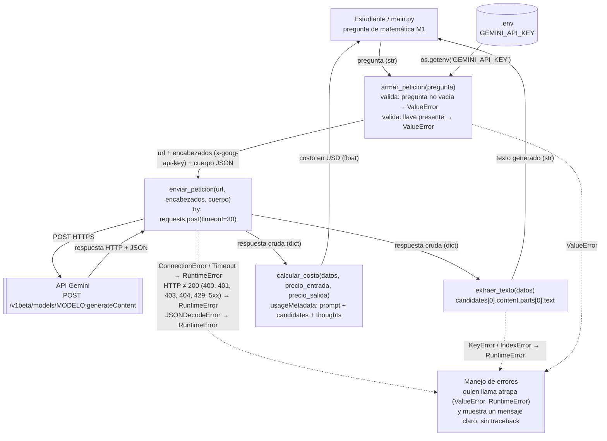

# Diagrama de arquitectura — PM1 (miniaplicación del Gate 1)

Camino de una pregunta de un estudiante de PAES M1, desde que se escribe hasta que vuelve la respuesta y su costo. Las cajas son las funciones reales de `src/consumir_gemini.py`; cada flecha indica el dato que transporta.

## Qué responde el diagrama

| Pregunta | Respuesta |
|---|---|
| Orden de las funciones | `armar_peticion` → `enviar_peticion` → `extraer_texto` (y `calcular_costo` sobre la misma respuesta cruda) |
| Dónde vive y se usa la llave | En `.env` (nunca en el repo). Solo `armar_peticion` la lee con `os.getenv` y la pone en el header `x-goog-api-key` |
| Dónde se manejan los errores | Validación en `armar_peticion`; conexión, tiempo límite, código HTTP y formato JSON en `enviar_peticion`; dato faltante en `extraer_texto` |
| Dónde se calcula el costo | En `calcular_costo`, después de recibir la respuesta, con `usageMetadata` |
| Qué cruza cada flecha | pregunta → URL + encabezados + cuerpo → JSON crudo → texto / costo |
